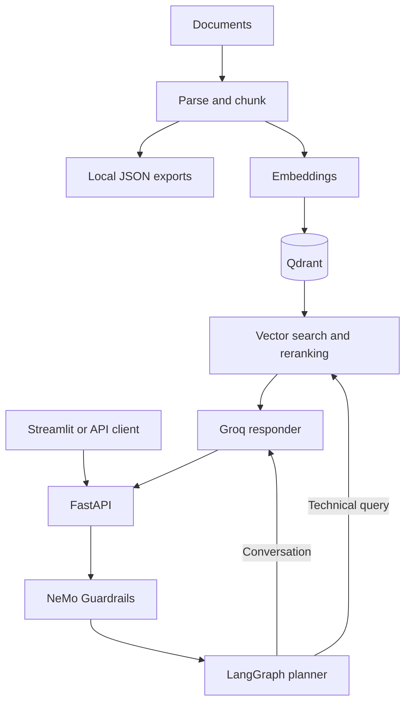

# Enterprise Agentic RAG

A document question-answering application built with FastAPI, Streamlit, LangGraph, Groq, and Qdrant. It ingests technical documents, retrieves relevant passages, and generates answers with conversation context.

## Features

- Document ingestion for PDF, text, HTML, and Office formats through dedicated loaders.
- Local JSON exports of parsed document chunks.
- Gemini embeddings with a local Sentence Transformers fallback.
- Qdrant vector search with retries and FlashRank reranking.
- LangGraph planner, retriever, and responder workflow.
- Conversation memory grouped by thread ID.
- NeMo Guardrails for request screening.
- Logfire spans and error logging across ingestion and query processing.
- Streamlit chat interface with retrieved context and workflow status.

## Architecture



## Requirements

- Python 3.11 or 3.12; the repository defaults to 3.11.
- A Groq API key with access to the configured generation and guardrail models.
- A running Qdrant instance or Qdrant Cloud cluster.
- A Gemini API key for Gemini embeddings, or the local embedding fallback.
- Internet access for hosted services and initial local model downloads.

Office parsing may require additional system dependencies depending on the file format, particularly legacy `.doc` and `.ppt` files.

## Setup

Run these commands from the repository root in PowerShell:

```powershell
git clone https://github.com/someshkp/enterprise-rag.git
cd enterprise-rag
python -m venv .venv
.\.venv\Scripts\Activate.ps1
python -m pip install --upgrade pip
pip install -r requirements.txt
```

Create a `.env` file in the repository root:

```dotenv
GROQ_API_KEY=your_groq_api_key
GEMINI_API_KEY=your_gemini_api_key
QDRANT_CLUSTER_ENDPOINT=https://your-cluster.cloud.qdrant.io
QDRANT_API_KEY=your_qdrant_api_key
QDRANT_TIMEOUT=30
PRIMARY_MODEL=openai/gpt-oss-120b
BACKEND_URL=http://localhost:8000

# Set this if sending traces to Logfire.
LOGFIRE_TOKEN=your_logfire_token
```

The Qdrant collection name is currently `enterprise_rag` in `app/config.py`. The guardrail model is configured separately in `app/guardrails/rails.py`.

Keep `.env` local; it is excluded by `.gitignore`.

## Ingest documents

The included data is organized into `DATA/true_data` and `DATA/noisy_data`. Folder names containing `true` or `noisy` determine the stored source type; other names use `general`.

```powershell
python -m app.ingestion.processor DATA
```

To process a single folder with an explicit source type:

```powershell
python -m app.ingestion.processor DATA/true_data true
```

To delete and recreate the configured Qdrant collection before ingestion:

```powershell
python -m app.ingestion.processor DATA --wipe
```

`--wipe` removes all existing vectors in that collection. Ingestion also writes chunks to `processed_data/<source_type>/<filename>.json`.

The directory scanner processes files in the immediate subfolders when subfolders exist. It does not recursively traverse arbitrary directory depths. Repeated ingestion creates new vector IDs and can duplicate documents unless the collection is rebuilt.

## Run the application

Start the API from the repository root:

```powershell
uvicorn app.main:app --reload --port 8000
```

In a second terminal, activate the virtual environment and start the chat interface:

```powershell
.\.venv\Scripts\Activate.ps1
streamlit run app/ui/app.py
```

Open the chat interface at `http://localhost:8501`. Interactive API documentation is available at `http://localhost:8000/docs`.

For custom frontend settings, export them in the terminal before starting Streamlit:

```powershell
$env:BACKEND_URL = "http://localhost:8000"
$env:LOGFIRE_TOKEN = "your_logfire_token"
streamlit run app/ui/app.py
```

The frontend currently looks for its dotenv file under `app/.env`, while the backend loads the root `.env`. Exporting these variables ensures the frontend receives them.

## API usage

| Method | Endpoint | Purpose |
| --- | --- | --- |
| GET | `/` | Basic API status message |
| POST | `/query` | Ask a question with an optional conversation thread ID |
| GET | `/graph` | Render the LangGraph workflow as a PNG |
| GET | `/docs` | Interactive API documentation |

Example query in PowerShell:

```powershell
$body = @{
    q = "How does Kubernetes pod autoscaling work?"
    thread_id = "demo-session"
} | ConvertTo-Json

Invoke-RestMethod -Method Post `
    -Uri "http://localhost:8000/query" `
    -ContentType "application/json" `
    -Body $body
```

The response includes `question`, `answer`, `thought_process` (workflow status steps), `status`, and `sources` (retrieved context strings). Reuse a thread ID for follow-up questions; use a unique ID for each independent conversation.

## Project structure

```text
app/
  main.py                    FastAPI endpoints
  config.py                  Environment-based settings
  agents/
    graph.py                 LangGraph workflow and memory
    nodes/                   Planner, retriever, and responder
  guardrails/                NeMo configuration and request screening
  ingestion/
    processor.py             Ingestion entry point
    loaders/                 Document parsers
    chunking/                Text splitting
  services/retrieval/        Embeddings, Qdrant search, and reranking
  ui/app.py                  Streamlit chat interface
DATA/                        Input documents
processed_data/              Exported document chunks
requirements.txt             pip dependencies
pyproject.toml               Project metadata and dependency constraints
uv.lock                      uv dependency lockfile
```

## Operational notes

- **Embedding consistency:** Gemini embeddings are configured for 3,072 dimensions; the local `all-mpnet-base-v2` fallback uses 768. Use the same embedding model for ingestion and querying. Switching models requires rebuilding the collection; otherwise queries can fail or retrieve incompatible vectors.
- **Memory:** Conversation history is stored in process memory and disappears on restart. Separate backend workers do not share it.
- **Fallback scope:** Embedding initialization can fall back to a local model, and reranking failures return the original retrieval order. `GROQ_FALLBACK_API_KEY` and `FALLBACK_MODEL` are declared in settings but are not wired into planner or responder failover.
- **Error handling:** Some failures return a JSON body with `status: "error"` rather than an HTTP error code. Inspect the response body and logs when troubleshooting.
- **Deployment:** The current API has no authentication or persistent conversation store. Add access control and durable storage before exposing it as a shared service.

## Troubleshooting

| Symptom | Check |
| --- | --- |
| Qdrant connection fails | Verify the cluster endpoint, API key, network access, and timeout. |
| Vector dimension mismatch | Rebuild the collection with the embedding model used for queries. |
| Groq rejects a request | Verify the API key, available models, and rate limits; guardrails use a separate hardcoded model. |
| No retrieved context | Check ingestion logs, extracted text, and the `enterprise_rag` collection contents. |
| UI reports backend offline | Start FastAPI and verify `BACKEND_URL` points to it. |
| Office parsing fails | Check `unstructured` dependencies for the document format. |
| Local models load slowly | Allow the first model download to finish and check cache permissions. |

Dependencies for evaluation and additional observability tools are listed in the project, but this repository currently has no automated evaluation suite or test runner configuration.
